


  

&nbsp;
<a href="https://www.linkedin.com/in/lucaslabonde/">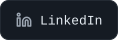</a>&nbsp;
<a href="mailto:labondepro@gmail.com">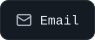</a>

  

<a href="https://github.com/Endikk/Claudy"></a><a href="https://github.com/Endikk/Claudio"></a><a href="https://github.com/Endikk/EVAN"></a><a href="https://github.com/Endikk/VroumVroum-r3f"></a>


  


  


